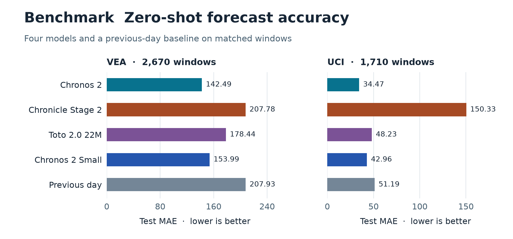
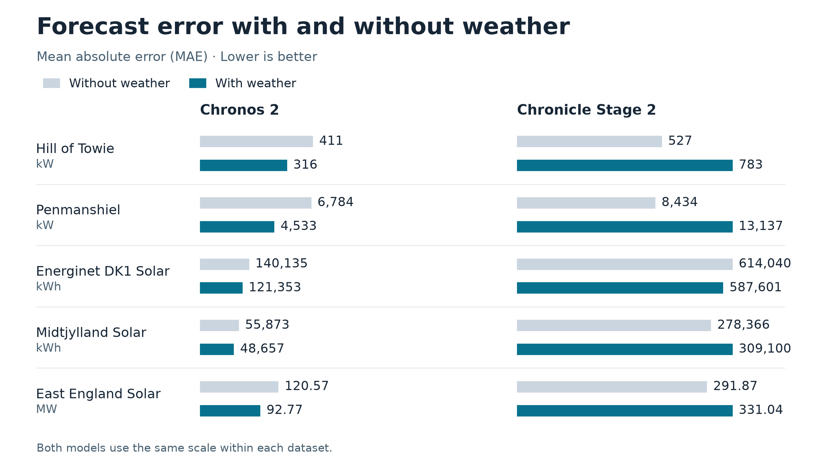
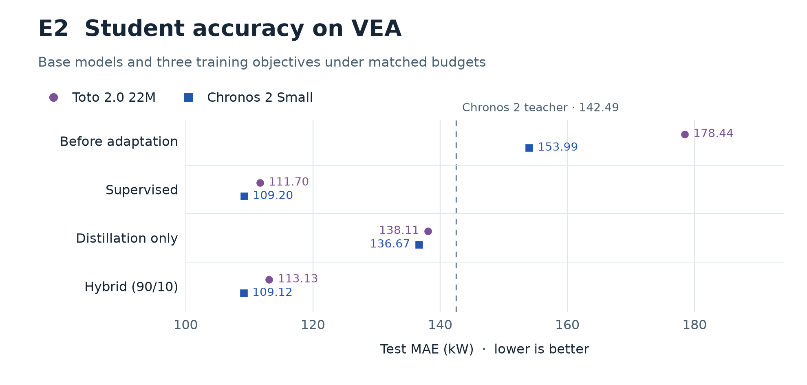
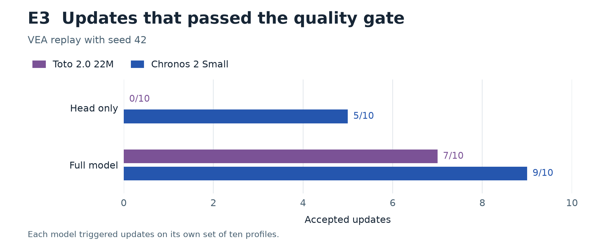

# EnergyFM Benchmarks

Compare Chronos 2, Chronicle, Toto 2.0 22M and Chronos 2 Small, then run the E1 weather-context, E2 distillation and E3 continual-learning experiments.

## Result figures









## Setup

Use Python 3.13 on macOS 15 or later on Apple silicon, Linux x86-64, or Windows x64. Open a terminal in the repository root.

**macOS and Linux**

```sh
python3.13 -m venv .venv
. .venv/bin/activate
```

**Windows Command Prompt**

```bat
py -3.13 -m venv .venv
.venv\Scripts\activate.bat
```

### CPU installation

Install the CPU build of PyTorch and then the project with pip. [PyTorch CPU packages](https://download.pytorch.org/whl/cpu/torch/)

```sh
python -m pip install --no-deps torch==2.10.0 --index-url https://download.pytorch.org/whl/cpu
python -m pip install ".[cpu]"
```

### CUDA installation on Linux and Windows

For CUDA 12.8, activate a Python 3.13 virtual environment and install the CUDA build of PyTorch and the project. Use a compatible NVIDIA GPU and driver.

```sh
python -m pip install --no-deps "torch==2.10.0+cu128" --index-url https://download.pytorch.org/whl/cu128
python -m pip install ".[cuda]"
python -c "import torch; print(torch.cuda.is_available())"
```

When the last command prints `True`, pass `--device cuda` to run an experiment on the GPU. The full report commands below already set it.

### Model weights and datasets

Download the pinned model versions and the VEA and UCI datasets.

```sh
python -m energyfm fetch models chronos chronicle toto chronos-small
python -m energyfm fetch data vea uci
```

The prepared E1 inputs are included in `data/e1/`. Model weights and the VEA and UCI archives are downloaded on first setup.

[Weather data by Open-Meteo.com](https://open-meteo.com/), licensed under [CC BY 4.0](https://creativecommons.org/licenses/by/4.0/). This attribution applies to the archived JSON forecasts for DK1, Hill of Towie, Midtjylland, and Penmanshiel. See [sources.json](data/e1/sources.json) for the file list and processing details.

## Try all four benchmarks

Run these commands in the same virtual environment.

```sh
python -m energyfm benchmark --limit 2
python -m energyfm e1 --limit 2
python -m energyfm e2 compare --smoke --dataset vea
python -m energyfm e2 compare --smoke --dataset uci
python -m energyfm e3 replay --smoke --model toto --seeds 42
python -m energyfm e3 replay --smoke --model chronos-small --seeds 42
```

The first command compares the four base models on the same windows. E1 compares forecasts with and without archived weather. E2 runs a small training comparison for each dataset. E3 screens one VEA profile per student and replays an update when triggered. Results are written to `runs/`.

## Reproduce the full report experiments

The E2 and E3 results in the report were produced with Python 3.13.18 and PyTorch 2.10.0 with CUDA 12.8 on an NVIDIA GeForce RTX 4060 Laptop GPU. To run the same experiment settings on the CPU, use the CPU installation and omit `--device cuda`. Inference and training times vary across runs and hardware.

Prepare the E2 teacher targets once per dataset and target type. On later runs, reuse the existing caches.

```sh
# E1 — five weather-context experiments and the single-site Midtjylland experiment
python -m energyfm e1 --experiment 01 02 03 08 09 --models chronos chronicle --device cuda
python -m energyfm e1 --experiment 08-single --models chronos --device cuda

# E2 — training objective comparison on VEA
python -m energyfm e2 prepare-targets --dataset vea --kind quantile --device cuda
python -m energyfm e2 compare --dataset vea --protocol fair --learning-rates 3e-5 1e-4 --seeds 42 --device cuda

# E2 — label-budget study on VEA and UCI
python -m energyfm e2 prepare-targets --dataset vea --kind point --device cuda
python -m energyfm e2 prepare-targets --dataset uci --kind point --device cuda
python -m energyfm e2 labels --datasets vea uci --models toto chronos-small --seeds 42 --device cuda

# E2 — matched inference benchmark
python -m energyfm e2 efficiency --protocol matched --device cuda

# E3 — replay on VEA
python -m energyfm e3 replay --model toto --seeds 42 --max-profiles 10 --device cuda
python -m energyfm e3 replay --model chronos-small --seeds 42 43 44 --max-profiles 10 --device cuda
```

For the Chronos 2 Small row with seed 42 in the report, use the candidates with `seed` equal to `42` from the three-seed run's `results.json`. Group them by update scope to calculate acceptance counts and mean shadow gains.

## Additional full comparisons

Run the four-model zero-shot benchmark on VEA and UCI and the E2 training objective comparison on UCI. Add `--device cuda` to run them on the GPU.

```sh
python -m energyfm benchmark
python -m energyfm e2 prepare-targets --dataset uci --kind quantile
python -m energyfm e2 compare --dataset uci
```
